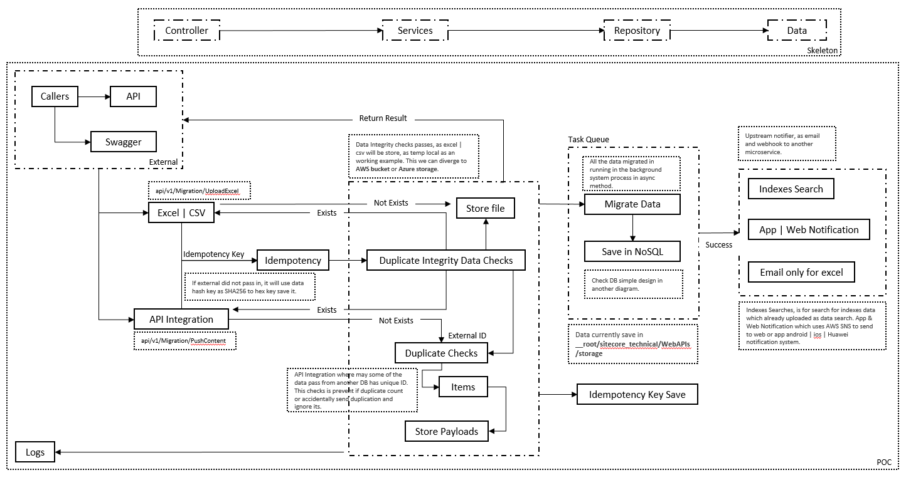
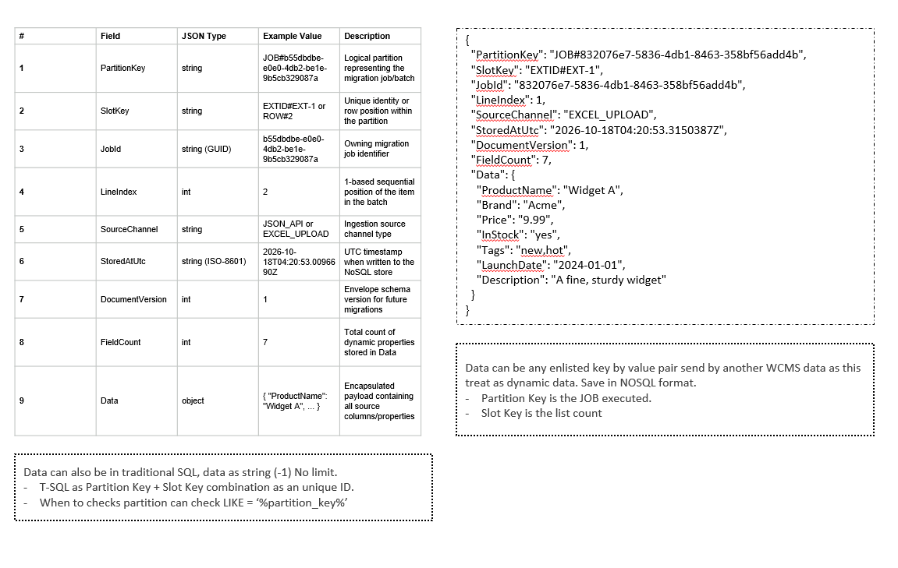

# WCMS Migration API (POC)

A proof-of-concept API for importing content into the WCMS from either a **JSON payload** or an **Excel/CSV upload**, persisting every column to a **file-backed NoSQL store**, and notifying upstream systems (search + mobile).

- Targets **.NET 6** (`net6.0`) -- `WebAPIs` (ASP.NET Core API) + `Libraries` (services, parsers, storage).
- Schema-agnostic: any title, any content, **any number of columns** are accepted and stored verbatim.
- Idempotent submission handling (safe re-sends / re-uploads).

---

## Architecture



## Data / storage model



Deeper detail:
- [`docs/ARCHITECTURE.md`](docs/ARCHITECTURE.md) -- end-to-end flow diagrams (Mermaid), middleware order, sequences, idempotency gates, worker graph.
- [`docs/NOSQL-SCHEMA.md`](docs/NOSQL-SCHEMA.md) -- document envelope, key rules, and tabular schema.

---

## Repository layout

```
api_sc.sln
|-- WebAPIs/                 # ASP.NET Core host + controllers
|   |-- Controllers/         # MigrationController, APIBase
|   |-- wwwroot/index.html   # landing page (redirects to Swagger)
|   `-- storage/             # runtime output (nosql + file) -- gitignored
|-- Libraries/               # reusable services
|   |-- ExcelParser/         # ExcelDataReader (.xls/.xlsx) + custom CSV
|   |-- NoSqlDocumentRepository/
|   |-- Idempotency/
|   |-- Storage/             # StorageLocator, UploadFileStore
|   |-- BackgroundProcess/   # in-memory queue + MigrationWorker
|   |-- Mailing/             # EmailService (log stub)
|   `-- WebhookNotifier/     # UpstreamNotifier
|-- docs/                    # architecture + schema (+ images)
`-- RunPocTests.vbs          # one-click build/run/smoke-test harness
```

---

## Prerequisites

- .NET SDK (the app targets `net6.0`; built/tested with the .NET 10 SDK).
- Windows (for the `RunPocTests.vbs` harness).

---

## Build & run

```powershell
# build
dotnet build WebAPIs/WebAPIs.csproj

# run (Development -> Swagger on)
dotnet run --project WebAPIs/WebAPIs.csproj
```

Then open:
- Swagger UI: <http://localhost:5233/swagger>
- Landing page: <http://localhost:5233/>

---

## Endpoints

| Method | Route | Body / Query | Success |
|---|---|---|---|
| POST | `/api/v1/Migration/PushContent` | JSON payload | `204 No Content` (duplicate -> `200`) |
| POST | `/api/v1/Migration/UploadExcel` | multipart `file` + `?notificationEmail=` | `202 Accepted` (duplicate -> `200`) |

Optional header on both: `Idempotency-Key: <key>`.

### JSON example

```json
{
  "sourceSystem": "MySystem",
  "items": [
    { "sku": "A1", "name": "Alpha", "qty": "5", "colour": "red" },
    { "sku": "A2", "name": "Beta",  "qty": "9", "colour": "blue" }
  ]
}
```

```powershell
curl -X POST http://localhost:5233/api/v1/Migration/PushContent `
  -H "Content-Type: application/json" `
  -H "Idempotency-Key: demo-001" `
  -d '{ "sourceSystem": "MySystem", "items": [ { "sku": "A1", "name": "Alpha" } ] }'
```

### Excel/CSV example

```powershell
curl -X POST "http://localhost:5233/api/v1/Migration/UploadExcel?notificationEmail=me@company.com" `
  -H "Idempotency-Key: demo-002" `
  -F "file=@sample.xlsx"
```

Row 1 must be the header row; every column becomes a field. Include an `ExternalId` column to make rows identity-based (re-imports then skip already-stored docs instead of duplicating).

---

## Storage output

Everything the run captures lands under `WebAPIs/storage` (gitignored):

```
storage/
|-- nosql/
|   |-- DOC_{source}_{externalId}.json     # identity mode (skip-if-exists)
|   |-- JOB_{jobId:N}_ROW_{n}.json         # positional mode (no ExternalId)
|   `-- idempotency/{SHA256(key)}.json     # submission key -> JobId
`-- file/{jobId:N}_{fileName}              # raw upload / JSON payload
```

---

## How to use `RunPocTests.vbs`

A self-contained harness that **builds, runs, and smoke-tests** the whole API (14 checks) -- no manual setup.

### Option A -- double-click (easiest)

Double-click `RunPocTests.vbs`. It re-launches itself inside a **persistent console** (`cmd.exe /k cscript`), so you watch live progress and the window stays open afterwards to read results.

### Option B -- from a terminal

```powershell
cscript //nologo RunPocTests.vbs
```

### What it does

1. Confirms the .NET SDK is present.
2. Builds `WebAPIs/WebAPIs.csproj`.
3. Generates test fixtures from embedded base64 (`.xlsx`, `.xls`) plus a `.csv`.
4. Starts the API in `Development` (`dotnet run`) and waits until it's ready.
5. Runs the checks:
   -- Swagger JSON / Swagger UI / landing page
   -- JSON API: valid, duplicate, empty, over-threshold
   -- Excel/CSV API: `.xlsx`, `.xls`, `.csv`, duplicate, empty file
   -- Storage: `storage/nosql` and `storage/file` populated
6. Prints `RESULT : N passed, M failed`.
7. Stops the API and **cleans up**: deletes the generated `testdata/` and the transient API log, **keeping `WebAPIs/storage`** as the captured output.

### Notes

- Exit code is `0` on success, `1` on failure (CI-friendly).
- Test fixtures are generated fresh each run (nothing to maintain).
- Because the folder is the artifact, inspect `WebAPIs/storage/nosql` after a run to see exactly what was imported.

---

## Configuration (`WebAPIs/appsettings.json`)

| Key | Default | Notes |
|---|---|---|
| `MigrationThresholds:MaxJsonItems` | 500 | `PushContent` -> `400` when exceeded |
| `MigrationThresholds:MaxExcelRows` | 10000 | `UploadExcel` -> `400` when exceeded |
| `MigrationThresholds:MaxExcelSizeMb` | 25 | `UploadExcel` -> `413` when exceeded |
| `MigrationThresholds:MaxJsonSizeMb` | 10 | declared (not enforced yet) |
| `StorageSettings:RootPath` | *(empty)* | empty -> `<content root>/storage` |
| `UpstreamSettings:*WebhookUrl` | placeholders | calls fail gracefully |

---

## POC limitations

- Idempotency marker is written *after* enqueue (concurrent identical calls can double-enqueue).
- No persisted job-status store (cannot answer "is it still running?").
- Background queue is in-memory (lost on restart).
- `EmailService` is a logging stub; upstream webhook URLs are placeholders.
